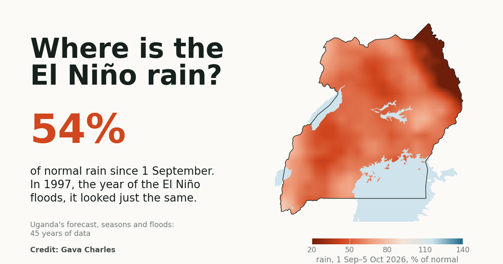
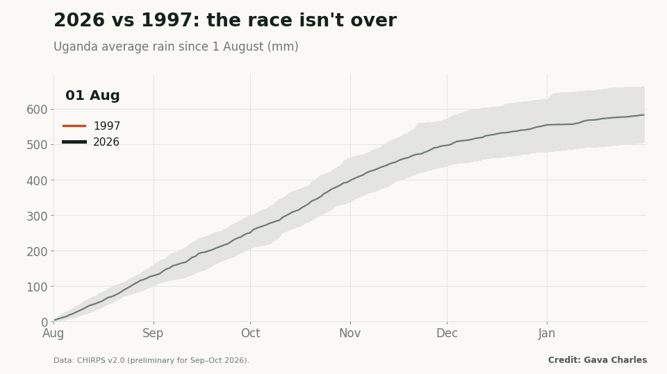
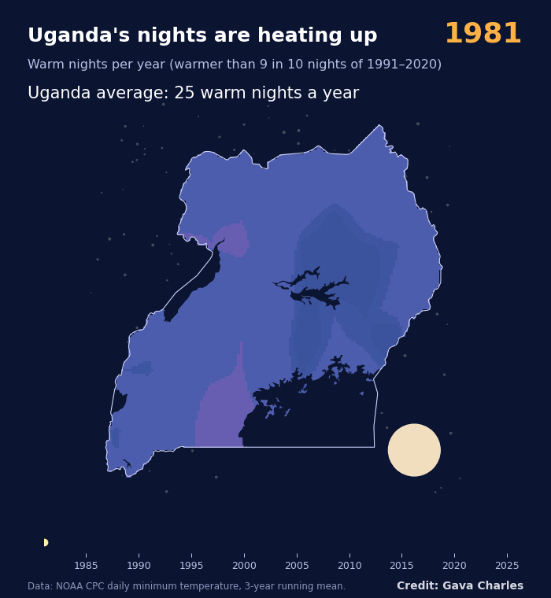

# Where is the El Niño rain?

**What 45 years of data say about Uganda's 2026 forecast, its shifting seasons, its hotter nights and its floods.**

This is the companion repository to the Substack article. It contains the full article and every graphic and animation, free to share with credit.

📖 **Read the article:** [article.md](article.md) · Substack: *[link to be added]*

## Key findings

| Question | Answer |
| --- | --- |
| Was the 2026 El Niño forecast wrong? | Not yet. Uganda had 54% of normal rain from 1 September to 5 October 2026, but in 1997, the El Niño flood year, it was just as dry on the same date. The Indian Ocean, not El Niño alone, decides the October–December rains. |
| Are the seasons changing? | Yes. The second rains are wetter and longer, especially in the north and Karamoja. Satellite vegetation records show the first season (March–July) weakening: crop drought rose from 11% to 23% of districts. |
| Is it hotter? | Yes, above all at night. Warm nights rose from about 22 a year (1981–1995) to about 60 a year (2011–2025). |
| Are Kampala's floods a climate problem? | So far, mostly a concrete problem. The 10-year storm hasn't grown since the 1980s, but paved surface rose from 57% to 72%. Paving alone has raised flood peaks about 60% since 1975, 3–5 times what climate change adds by the 2050s. |
| Where is Uganda short of water? | Karamoja (semi-arid, up to 8 dry months a year), then a dry belt across Acholi, Lango and Teso, the Ankole rangelands and the Rwenzori rain shadow. |
| What should NDP IV do? | Plant by the data, size irrigation and water storage region by region, design drains for the city as it will be built, and open the national rainfall archive. |

## Contents

| Folder | What's inside |
| --- | --- |
| [`article.md`](article.md) | The full article with all graphics embedded |
| [`images/`](images/) | Social-ready graphics (16:9), city cards, the Substack cover and the social preview card |
| [`images/extra/`](images/extra/) | More detailed figures from the underlying report |
| [`animations/`](animations/) | GIFs: 2026 vs 1997 rainfall race, Uganda's nights heating up, and built-up growth of Kampala, Nairobi, Dar es Salaam, Lagos and Johannesburg (1975–2030) |

### Animations

| | |
| --- | --- |
|  |  |
| 2026 vs 1997, day by day | Uganda's nights heating up, 1981–2025 |

## Data sources

All data are public:

- **Rainfall:** CHIRPS v2.0 (UCSB Climate Hazards Center), daily 1981–2026 (preliminary for September–October 2026); ARC2 (NOAA CPC) as a cross-check; GHCN-Daily rain gauges (NOAA NCEI) to correct satellite extremes to gauge level.
- **Temperature:** NOAA CPC daily minimum and maximum temperature; NASA POWER (MERRA-2); GHCN-CAMS.
- **Vegetation:** NOAA STAR Vegetation Health Products (VCI over cropland), 1982–2025.
- **Oceans:** NOAA ERSST v5 (Niño-3.4, Indian Ocean Dipole); NOAA CPC Oceanic Niño Index.
- **Cities:** JRC Global Human Settlement Layer (built-up surface 1975–2030), ESA WorldCover 2021, Copernicus GLO-30 elevation model, geoBoundaries, OpenStreetMap.
- **Food security:** FEWS NET IPC classifications.
- **Projections:** 16 CMIP6 climate models (SSP2-4.5 and SSP5-8.5).
- **Policy:** Uganda's Fourth National Development Plan (NDP IV) and the Ministry of Water and Environment Strategic Development Plan 2025/26–2029/30.

## Methods in brief

- **Seasons:** onset and cessation from daily rainfall; crop water stress from a FAO-type water balance (WRSI) for maize and beans.
- **Trends:** Mann–Kendall tests and Sen's slope, with results checked across two rainfall datasets and two season definitions.
- **Floods:** for 154 drainage catchments in five cities, SCS curve-number runoff with design storms corrected to gauge level. Rainfall and land-cover effects are separated by Shapley decomposition with 4,000 Monte Carlo runs each.
- **Climate uplift:** about 7% more storm rain per °C of projected warming.

These analyses are being prepared for peer-reviewed publication. Full methods will be linked here when published.

## Caveats

- Rainfall for September–October 2026 is preliminary and may be revised. Figures are as of 5 October 2026.
- Satellite rainfall smooths out local downpours, so storm depths are corrected with gauge records, which are thin and old for Uganda (public daily records end in 1986).
- Design numbers are screening values. Final engineering designs should use local gauge data from the Uganda National Meteorological Authority.

## Credit and licence

Article and graphics by **Gava Charles**. Licensed under [Creative Commons Attribution 4.0 (CC BY 4.0)](LICENSE). You're free to share and adapt them, including commercially, as long as you credit "Gava Charles" and link back here.
